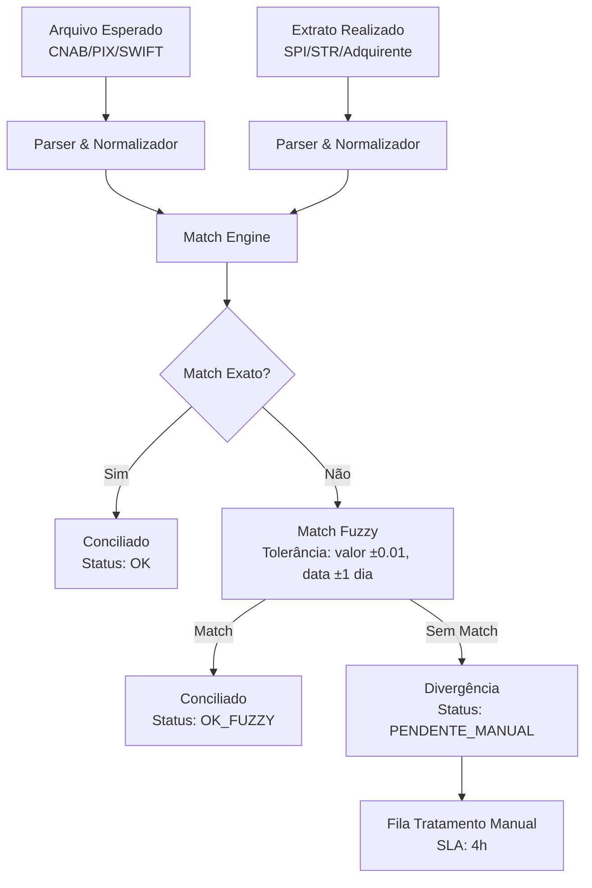

# Skill: Conciliação Financeira

> **Domínio**: Match entre esperado vs realizado (extrato bancário vs lançamentos contábeis).
> **Regulatório**: Bacen Cir. 3.978/2020, Res. 1/2020 (PIX), SPB.
> **SLA Crítico**: D+0 (conciliação no mesmo dia da liquidação) — PIX < 10s, TED < 30min.

---

## 1. Contexto de Negócio

### 1.1 Tipos de Conciliação

| Tipo | Fonte Esperada | Fonte Realizada | SLA | Complexidade |
|------|----------------|-----------------|-----|--------------|
| **PIX** | Payload PIX (DICT/PSP) | Extrato SPI/STR | < 10s | Alta (volume, tempo real) |
| **TED** | Arquivo CNAB 240/400 | Extrato STR | < 30min | Média |
| **DOC** | Arquivo CNAB | Extrato STR | D+1 | Baixa |
| **Cartões** | Arquivo Bandeira (Visa/Master/Elo) | Extrato Adquirente | D+0 | Alta (chargebacks, parcelado) |
| **Câmbio** | SWIFT/BCB | Extrato Correspondente | D+0 | Média |
| **Custódia** | B3/Cetip | Custodiante | D+0 | Alta |

### 1.2 Match Engine (Algoritmo)



### 1.3 Regras de Match (Prioridade)

| Prioridade | Critério | Tolerância | Exemplo |
|------------|----------|------------|---------|
| 1 | **Chave Primária** (EndToEndId PIX, NSU TED, NSU Cartão) | Exata | `EndToEndId = "E123456789"` |
| 2 | **Valor + Data + Conta** | Valor ± R$ 0,01, Data ± 1 dia | Valor: 1000.00 ± 0.01 |
| 3 | **Valor + Data + CPF/CNPJ** | Valor exato, Data ± 1 dia | CPF pagador/recebedor |
| 4 | **Fuzzy Avançado** (ML-based) | Score ≥ 0.95 | Similaridade nome, valor próximo |

### 1.4 SLA Regulatório (Bacen Cir. 3.978)

| Evento | Prazo Máximo | Penalidade |
|--------|--------------|------------|
| Conciliação PIX | Tempo real (< 10s pós-liquidação) | Multa diária + restrição operacional |
| Conciliação TED | 30 min pós-liquidação | Multa + restrição |
| Conciliação Cartões | D+0 (até 18h) | Multa + suspensão adquirente |
| Relatório Divergências | D+1 (até 10h) | Multa progressiva |

---

## 2. Modelos de Domínio

### 2.1 Aggregate: Conciliação

```java
// domain/model/Conciliacao.java
@Entity
public class Conciliacao {
    
    @Id
    private ConciliacaoId id;                    // UUID v7
    
    private TipoConcilicao tipo;                 // PIX, TED, CARTAO, CAMBIO
    
    @Embedded
    private LancamentoEsperado esperado;         // Value Object (lado "deveria")
    
    @Embedded
    private LancamentoRealizado realizado;       // Value Object (lado "real")
    
    @Enumerated(EnumType.STRING)
    private StatusConciliacao status;            // OK, OK_FUZZY, DIVERGENTE, MANUAL
    
    private MatchDetails matchDetails;           // Como fez match (exato, fuzzy, score)
    
    private DivergenciaDetails divergencia;      // Se DIVERGENTE/MANUAL
    
    private Instant dataLiquidacao;              // Timestamp liquidação
    private Instant dataConcilicacao;            // Quando conciliou
    private String idempotencyKey;               // Chave única (EndToEndId/NSU)
    
    // Factory
    public static Conciliacao criar(LancamentoEsperado esperado, 
                                     LancamentoRealizado realizado,
                                     MatchEngine matchEngine) {
        Conciliacao c = new Conciliacao();
        c.id = ConciliacaoId.novo();
        c.esperado = esperado;
        c.realizado = realizado;
        c.tipo = inferirTipo(esperado, realizado);
        c.idempotencyKey = gerarChaveIdempotencia(esperado, realizado);
        
        // Match Engine decide
        MatchResult result = matchEngine.match(esperado, realizado);
        c.status = result.getStatus();
        c.matchDetails = result.getDetails();
        
        if (result.isDivergente()) {
            c.divergencia = DivergenciaDetails.from(result);
        }
        
        c.dataLiquidacao = realizado.getDataLiquidacao();
        c.dataConcilicacao = Instant.now();
        
        // Domain Event
        c.registerEvent(new ConciliacaoExecutada(c.id, c.tipo, c.status, c.matchDetails));
        
        if (c.status == StatusConciliacao.DIVERGENTE || 
            c.status == StatusConciliacao.MANUAL) {
            c.registerEvent(new DivergenciaDetectada(c.id, c.divergencia));
        }
        
        return c;
    }
}
```

### 2.2 Value Objects

```java
// domain/model/valueobjects/

@Value
@Builder
public class LancamentoEsperado {
    String endToEndId;           // PIX: EndToEndId | TED: NSU | Cartão: NSU
    BigDecimal valor;            // 2 casas, positivo
    LocalDate data;              // Data esperada
    String contaOrigem;          // Agência/Conta
    String contaDestino;         // Agência/Conta
    String cpfCnpjPagador;       // Hash + salt
    String cpfCnpjRecebedor;     // Hash + salt
    String descricao;            // Descrição livre
    Map<String, String> metadados; // Flexível por tipo
}

@Value
@Builder
public class LancamentoRealizado {
    String idExtrato;            // ID único no extrato (NSU, sequência)
    BigDecimal valor;            // Valor liquidado
    LocalDateTime dataLiquidacao; // Timestamp exato
    String contaDebito;          // Conta debitada
    String contaCredito;         // Conta creditada
    String codigoRetorno;        // Código bancário (ex: 03 = liquidado)
    String descricaoBanco;       // Descrição do banco
}

@Value
public class MatchDetails {
    MatchType tipo;              // EXATO, FUZZY_VALOR_DATA, FUZZY_AVANCADO, SEM_MATCH
    Double score;                // 0.0 a 1.0
    List<String> camposMatch;    // Quais campos bateram
    List<String> camposDivergentes; // Quais não bateram
    String algoritmoVersao;      // v1.2.3
}

@Value
public class DivergenciaDetails {
    DivergenciaTipo tipo;        // VALOR, DATA, CONTA, NAO_ENCONTRADO, DUPLICADO
    String descricao;            // Legível por humano
    BigDecimal diferencaValor;   // Se VALOR
    Duration diferencaTempo;     // Se DATA
    String acaoSugerida;         // EX: "Verificar arquivo CNAB retorno"
    PrioridadeTratamento prioridade; // ALTA, MEDIA, BAIXA
}
```

### 2.3 Domain Events

```java
// domain/event/
@Value
public class ConciliacaoExecutada implements DomainEvent {
    String eventType = "ConciliacaoExecutada";
    ConciliacaoId aggregateId;
    TipoConcilicao tipo;
    StatusConciliacao status;
    MatchDetails matchDetails;
    Instant timestamp = Instant.now();
    String correlationId;
    String causationId;
}

@Value
public class DivergenciaDetectada implements DomainEvent {
    String eventType = "DivergenciaDetectada";
    ConciliacaoId aggregateId;
    DivergenciaDetails divergencia;
    Instant timestamp = Instant.now();
    String correlationId;
    String causationId;
}

@Value
public class DivergenciaResolvida implements DomainEvent {
    String eventType = "DivergenciaResolvida";
    ConciliacaoId aggregateId;
    String resolvidoPor;      // User ID
    String acaoTomada;        // EX: "Ajuste valor R$ 0,01", "Reprocessar arquivo"
    Instant timestamp = Instant.now();
    String correlationId;
    String causationId;
}
```

---

## 3. Match Engine (Core Algorithm)

```java
// domain/service/MatchEngine.java
@Component
public class MatchEngine {
    
    private final FuzzyMatcher fuzzyMatcher;
    private final MLEngine mlEngine; // Opcional: scoring avançado
    
    public MatchResult match(LancamentoEsperado esperado, LancamentoRealizado realizado) {
        // 1. Match Exato (Prioridade 1)
        if (matchExato(esperado, realizado)) {
            return MatchResult.exato(extrairCamposMatch(esperado, realizado));
        }
        
        // 2. Match Valor + Data + Conta (Prioridade 2)
        if (matchValorDataConta(esperado, realizado)) {
            return MatchResult.fuzzyValorData(extrairCamposMatch(esperado, realizado));
        }
        
        // 3. Match Valor + Data + CPF/CNPJ (Prioridade 3)
        if (matchValorDataCpfCnpj(esperado, realizado)) {
            return MatchResult.fuzzyValorDataCpf(extrairCamposMatch(esperado, realizado));
        }
        
        // 4. Fuzzy Avançado / ML (Prioridade 4)
        if (mlEngine != null) {
            double score = mlEngine.score(esperado, realizado);
            if (score >= 0.95) {
                return MatchResult.fuzzyAvancado(score, extrairCamposMatch(esperado, realizado));
            }
        }
        
        // 5. Sem Match → Divergência
        return MatchResult.semMatch(identificarDivergencia(esperado, realizado));
    }
    
    private boolean matchExato(LancamentoEsperado e, LancamentoRealizado r) {
        // PIX: EndToEndId | TED: NSU | Cartão: NSU
        return Objects.equals(e.getEndToEndId(), r.getIdExtrato());
    }
    
    private boolean matchValorDataConta(LancamentoEsperado e, LancamentoRealizado r) {
        return BigDecimal.ZERO.compareTo(e.getValor().subtract(r.getValor()).abs()) <= 0 // ±0.01
            && Duration.between(e.getData().atStartOfDay(), r.getDataLiquidacao().toLocalDate().atStartOfDay()).abs().toDays() <= 1
            && (Objects.equals(e.getContaDestino(), r.getContaCredito()) 
                || Objects.equals(e.getContaOrigem(), r.getContaDebito()));
    }
}
```

---

## 4. Outbox Pattern (Garantia de Publicação)

```java
// infrastructure/messaging/ConciliacaoOutboxPublisher.java
@Component
@RequiredArgsConstructor
public class ConciliacaoOutboxPublisher {
    
    private final OutboxRepository outbox;
    private final KafkaTemplate<String, Object> kafka;
    private final BankingTracer tracer;
    
    @Scheduled(fixedDelay = 50) // 20x/seg para tempo real PIX
    @Transactional
    public void publish() {
        List<OutboxEvent> events = outbox.findUnpublishedByPriority(500);
        
        for (OutboxEvent event : events) {
            tracer.traceEvent("concilicacao", event.getEventType(), event.getAggregateId(), () -> {
                // PIX: topic de alta prioridade, partitions por EndToEndId
                // TED/Cartão: topic padrão
                String topic = resolverTopico(event.getEventType());
                String key = event.getAggregateId(); // Partition by ID
                
                kafka.send(topic, key, event.getPayload())
                    .whenComplete((result, ex) -> {
                        if (ex == null) {
                            event.markPublished();
                            // Métrica: outbox.latency.ms
                        } else {
                            // Métrica: outbox.error.rate
                            log.error("Falha publicação conciliação: {}", event.getEventId(), ex);
                        }
                    });
                return null;
            });
        }
    }
    
    private String resolverTopico(String eventType) {
        return switch (eventType) {
            case "ConciliacaoExecutada" -> "banking.concilicacao.executed.priority";
            case "DivergenciaDetectada" -> "banking.concilicacao.divergence.priority";
            case "DivergenciaResolvida" -> "banking.concilicacao.resolved";
            default -> "banking.concilicacao.events";
        };
    }
}
```

---

## 5. SLA Monitoring & Alertas

```java
// infrastructure/observability/ConciliacaoSlaMonitor.java
@Component
@RequiredArgsConstructor
public class ConciliacaoSlaMonitor {
    
    private final MeterRegistry meterRegistry;
    private final AlertService alertService;
    
    @EventListener
    public void onConciliacaoExecutada(ConciliacaoExecutada event) {
        Duration sla = calcularSla(event.getTipo(), event.getTimestamp());
        
        // Métricas
        Timer.Sample sample = Timer.start(meterRegistry);
        sample.stop(Timer.builder("banking.concilicacao.sla")
            .tag("tipo", event.getTipo().name())
            .tag("status", event.getStatus().name())
            .tag("sla_compliant", String.valueOf(sla.isCompliant()))
            .register(meterRegistry));
        
        // Alerta se SLA violado
        if (!sla.isCompliant()) {
            alertService.fire(Alert.builder()
                .title("SLA Conciliação Violado")
                .description(String.format("Tipo: %s | SLA: %s | Threshold: %s", 
                    event.getTipo(), sla.getActual(), sla.getThreshold()))
                .severity(AlertSeverity.CRITICAL)
                .tags(Map.of("tipo", event.getTipo().name(), "domain", "concilicacao"))
                .build());
        }
    }
    
    private SlaResult calcularSla(TipoConcilicao tipo, Instant timestamp) {
        return switch (tipo) {
            case PIX -> new SlaResult(Duration.ofSeconds(10), Duration.between(timestamp, Instant.now()));
            case TED -> new SlaResult(Duration.ofMinutes(30), Duration.between(timestamp, Instant.now()));
            case CARTAO -> new SlaResult(Duration.ofHours(12), Duration.between(timestamp, Instant.now())); // até 18h
            default -> new SlaResult(Duration.ofHours(24), Duration.between(timestamp, Instant.now()));
        };
    }
}
```

---

## 5. Testes (Eval Gates)

### 5.1 Golden Set (Match Engine)

```yaml
# evals/golden-set-conciliacao.yaml
test_cases:
  - id: "conc-001-pix-exato"
    description: "PIX match exato por EndToEndId"
    input:
      esperado:
        endToEndId: "E1234567890123456789"
        valor: 1000.00
        data: "2024-01-15"
      realizado:
        idExtrato: "E1234567890123456789"
        valor: 1000.00
        dataLiquidacao: "2024-01-15T10:30:00"
    expected:
      status: "OK"
      match_type: "EXATO"
      score: 1.0
  
  - id: "conc-002-ted-fuzzy-valor-data"
    description: "TED match fuzzy valor ±0.01 + data ±1 dia"
    input:
      esperado:
        endToEndId: "TED987654321"
        valor: 5000.00
        data: "2024-01-15"
        contaDestino: "1234-5"
      realizado:
        idExtrato: "NSU123456"
        valor: 5000.01
        dataLiquidacao: "2024-01-16T14:30:00"
        contaCredito: "1234-5"
    expected:
      status: "OK_FUZZY"
      match_type: "FUZZY_VALOR_DATA"
      score: 0.98
  
  - id: "conc-003-cartao-divergencia-valor"
    description: "Cartão divergência valor (chargeback)"
    input:
      esperado:
        endToEndId: "CARTAO123"
        valor: 250.00
        data: "2024-01-15"
      realizado:
        idExtrato: "CARTAO123"
        valor: 200.00
        dataLiquidacao: "2024-01-15T18:00:00"
    expected:
      status: "DIVERGENTE"
      divergencia_tipo: "VALOR"
      diferenca: 50.00
  
  - id: "conc-004-pix-nao-encontrado"
    description: "PIX no extrato sem correspondente esperado"
    input:
      realizado:
        idExtrato: "E999999999"
        valor: 100.00
        dataLiquidacao: "2024-01-15T10:30:00"
    expected:
      status: "DIVERGENTE"
      divergencia_tipo: "NAO_ENCONTRADO"

thresholds:
  match_rate: 0.999
  sla_pix_seconds: 10
  sla_ted_minutes: 30
  sla_cartao_hours: 12
  divergence_resolution_hours: 4
  false_positive_rate: 0.001
```

### 5.2 Performance Tests

```java
// test/performance/ConciliacaoPerformanceTest.java
@SpringBootTest
@Testcontainers
class ConciliacaoPerformanceTest {
    
    @Container
    static KafkaContainer kafka = new KafkaContainer("confluentinc/cp-kafka:7.5.0");
    
    @Test
    void deveProcessar10kPIXPorSegundo() {
        // Given: 10k PIX em lote
        List<ConciliacaoInput> inputs = gerar10kPix();
        
        // When: Processa conciliação
        long start = System.currentTimeMillis();
        List<ConciliacaoResult> results = matchEngine.batchMatch(inputs);
        long elapsed = System.currentTimeMillis() - start;
        
        // Then: Throughput ≥ 10k/s, latência P99 < 50ms
        double throughput = 10000.0 / (elapsed / 1000.0);
        assertTrue(throughput >= 10000, "Throughput: " + throughput + " ops/s");
        
        long p99 = percentile(results.stream().mapToLong(r -> r.getLatencyMs()).toArray(), 99);
        assertTrue(p99 < 50, "P99 latency: " + p99 + "ms");
    }
}
```

---

## 6. Pipeline Específico (Harness)

```yaml
# .harness/ci/concilicacao-ci.yaml
stages:
  - stage: Conciliação Specific Tests
    identifier: conciliacao_tests
    spec:
      execution:
        steps:
          - step:
              name: Match Engine Tests (Unit + Integration)
              identifier: match_engine_tests
              type: Run
              spec:
                command: ./mvnw test -Dtest=*MatchEngineTest,*ConciliacaoEngineTest
          - step:
              name: SLA Validation Tests
              identifier: sla_tests
              type: Run
              spec:
                command: ./mvnw test -Dtest=*SlaTest,*ConciliacaoSlaTest
          - step:
              name: Chaos Tests (Kafka Lag, Broker Down)
              identifier: chaos_tests
              type: Run
              spec:
                command: ./mvnw test -Dtest=*ChaosTest -Dchaos.kafka.enabled=true
          - step:
              name: Performance Test (10k PIX/s)
              identifier: perf_test
              type: Run
              spec:
                command: ./mvnw test -Dtest=*PerformanceTest -Dperf.threshold=10000
          - step:
              name: Contract Tests (PIX/TED/Cartão APIs)
              identifier: contract_tests
              type: Run
              spec:
                command: ./mvnw test -Dtest=*PactTest -Dpact.provider=concilicacao
```

---

## 7. Checklist de Deploy (Conciliação)

```markdown
# Pré-deploy Conciliação
- [ ] Golden set match rate ≥ 99.9%
- [ ] Red teaming: 0 injection/PII/financial vulnerabilities
- [ ] SLA PIX: P99 < 10s (liquidação → conciliação)
- [ ] SLA TED: P99 < 30min
- [ ] SLA Cartões: P99 < 12h (até 18h)
- [ ] Match fuzzy: Score threshold ≥ 0.95
- [ ] Divergência: Fila manual SLA < 4h
- [ ] Outbox: Zero eventos perdidos (teste Kafka down 5min)
- [ ] Idempotência: EndToEndId/NSU único (teste duplicação)
- [ ] Rollback: < 30s (feature flag)
- [ ] Auditoria: Trilha imutável (ConciliacaoExecutada, DivergenciaDetectada/Resolvida)
- [ ] Métricas: SLA compliance, match rate, divergence rate, latency P99
```

---

## 8. Métricas de Sucesso

| Métrica | Target | Alert |
|---------|--------|-------|
| Match Rate (Automático) | ≥ 99.9% | < 99.5% |
| SLA PIX (P99) | < 10s | > 15s |
| SLA TED (P99) | < 30min | > 45min |
| SLA Cartões (P99) | < 12h | > 18h |
| Divergência → Resolução | < 4h | > 8h |
| False Positive Rate | < 0.1% | > 0.5% |
| Throughput PIX | ≥ 10k/s | < 5k/s |
| Rollback Time | < 30s | > 60s |

---

*Skill versionada — atualize com nova regulamentação Bacen, novo tipo de pagamento, ou lição de produção.*