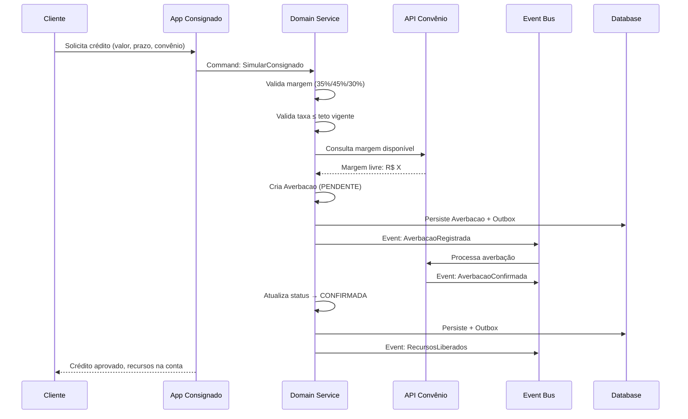

# Skill: Crédito Consignado

> **Domínio**: Operações de crédito com desconto em folha (consignação).
> **Regulatório**: Bacen Res. 4.935/2021, Lei 10.820/2003, LGPD.
> **Criticidade**: Alta — erro = prejuízo financeiro + risco regulatório + reputacional.

---

## 1. Contexto de Negócio (Domain Knowledge)

### 1.1 Conceitos Fundamentais

| Conceito | Definição | Regra Regulatória |
|----------|-----------|-------------------|
| **Margem Consignável** | % da renda líquida passível de desconto | CLT: 35% | Servidor: 45% | INSS: 30% (Bacen Res. 4.935 Art. 3º) |
| **Convênio** | Acordo entre pagador (órgão/empresa) e banco | Cadastro prévio, homologação, vigência |
| **Averbação** | Registro do desconto na folha do convênio | Obrigatória antes de liberar recursos (Art. 7º) |
| **Taxa Teto** | Taxa máxima efetiva permitida | Definida pelo CMN, publicada pelo Bacen |
| **Portabilidade** | Transferência de operação entre instituições | Prazo: 5 dias úteis (Art. 12º) |
| **Refinanciamento** | Nova operação para quitar anterior | Nova averbação, nova margem |

### 1.2 Fluxo Principal (Happy Path)



### 1.3 Regras de Negócio (Invariantes)

```java
// Domain Service — Regras puras (zero dependências externas)
public class ConsignadoRules {
    
    // Regra 1: Margem consignável
    public static void validarMargem(BigDecimal rendaLiquida, BigDecimal valorParcela, 
                                     TipoVinculo vinculo, List<Averbacao> averbacoesAtivas) {
        BigDecimal margemMaxima = switch (vinculo) {
            case CLT -> rendaLiquida.multiply(BigDecimal.valueOf(0.35));
            case SERVIDOR_PUBLICO -> rendaLiquida.multiply(BigDecimal.valueOf(0.45));
            case INSS -> rendaLiquida.multiply(BigDecimal.valueOf(0.30));
        };
        
        BigDecimal comprometido = averbacoesAtivas.stream()
            .map(Averbacao::getValorParcela)
            .reduce(BigDecimal.ZERO, BigDecimal::add)
            .add(valorParcela);
        
        if (comprometido.compareTo(margemMaxima) > 0) {
            throw new MargemInsuficienteException(
                "Margem excedida: comprometido " + comprometido + " > margem " + margemMaxima
            );
        }
    }
    
    // Regra 2: Taxa efetiva ≤ teto vigente
    public static void validarTaxa(BigDecimal taxaEfetiva, BigDecimal taxaTetoVigente) {
        if (taxaEfetiva.compareTo(taxaTetoVigente) > 0) {
            throw new TaxaAcimaTetoException(
                "Taxa " + taxaEfetiva + " > teto " + taxaTetoVigente
            );
        }
    }
    
    // Regra 3: Averbação antes de liberar
    public static void validarAverbacaoConfirmada(Averbacao averbacao) {
        if (averbacao.getStatus() != StatusAverbacao.CONFIRMADA) {
            throw new AverbacaoNaoConfirmadaException(
                "Liberação só após averbação confirmada pelo convênio"
            );
        }
    }
    
    // Regra 4: Portabilidade em 5 dias úteis
    public static void validarPrazoPortabilidade(LocalDate solicitacao, LocalDate conclusao) {
        long diasUteis = ChronoUnit.DAYS.between(solicitacao, conclusao);
        if (diasUteis > 5) {
            throw new PrazoPortabilidadeExcedidoException(
                "Portabilidade deve concluir em 5 dias úteis (Bacen Res. 4.935 Art. 12º)"
            );
        }
    }
}
```

---

## 2. Modelos de Domínio (Hexagonal)

### 2.1 Aggregate Root: Averbacao

```java
// domain/model/Averbacao.java
@Entity
public class Averbacao {
    
    @Id
    private AverbacaoId id;                    // UUID v7 (tempo + random)
    
    @Embedded
    private ClienteId clienteId;               // Value Object
    
    @Embedded
    private ConvenioId convenioId;             // Value Object
    
    private BigDecimal valorParcela;           // Valor da parcela (2 casas)
    private Integer numeroParcelas;            // Prazo em meses
    private BigDecimal taxaEfetiva;            // 4 casas decimais
    private BigDecimal valorTotal;             // Calculado
    
    @Enumerated(EnumType.STRING)
    private StatusAverbacao status;            // PENDENTE, CONFIRMADA, REJEITADA, CANCELADA
    
    private LocalDateTime dataCriacao;         // Instant.now()
    private LocalDateTime dataConfirmacao;     // Quando CONFIRMADA
    private String idempotencyKey;             // Chave única por solicitação
    
    // Factory Method (garante invariantes)
    public static Averbacao criar(SolicitacaoConsignado cmd, BigDecimal taxaTeto) {
        ConsignadoRules.validarMargem(...);
        ConsignadoRules.validarTaxa(cmd.getTaxaEfetiva(), taxaTeto);
        
        Averbacao averbacao = new Averbacao();
        averbacao.id = AverbacaoId.novo();
        averbacao.clienteId = cmd.getClienteId();
        averbacao.convenioId = cmd.getConvenioId();
        averbacao.valorParcela = cmd.getValorParcela();
        averbacao.numeroParcelas = cmd.getNumeroParcelas();
        averbacao.taxaEfetiva = cmd.getTaxaEfetiva();
        averbacao.valorTotal = cmd.getValorParcela().multiply(BigDecimal.valueOf(cmd.getNumeroParcelas()));
        averbacao.status = StatusAverbacao.PENDENTE;
        averbacao.dataCriacao = LocalDateTime.now();
        averbacao.idempotencyKey = cmd.getIdempotencyKey();
        
        // Domain Event
        averbacao.registerEvent(new AverbacaoRegistrada(
            averbacao.getId(), averbacao.getClienteId(), averbacao.getConvenioId(),
            averbacao.getValorParcela(), averbacao.getNumeroParcelas()
        ));
        
        return averbacao;
    }
    
    // Command: Confirma averbação (chamado pelo convênio)
    public void confirmar(LocalDateTime dataConfirmacao) {
        if (this.status != StatusAverbacao.PENDENTE) {
            throw new IllegalStateException("Só pode confirmar PENDENTE");
        }
        this.status = StatusAverbacao.CONFIRMADA;
        this.dataConfirmacao = dataConfirmacao;
        this.registerEvent(new AverbacaoConfirmada(this.id, dataConfirmacao));
    }
    
    // Command: Libera recursos (após confirmação)
    public void liberarRecursos() {
        ConsignadoRules.validarAverbacaoConfirmada(this);
        this.registerEvent(new RecursosLiberados(this.id, this.valorTotal));
    }
}
```

### 2.2 Value Objects

```java
// domain/model/valueobjects/
@Value
public class AverbacaoId {
    UUID value;
    public static AverbacaoId novo() { return new AverbacaoId(UUID.randomUUID()); }
}

@Value
public class ClienteId { String value; }  // CPF hash + salt

@Value  
public class ConvenioId { String value; } // CNPJ convênio

@Value
public class TaxaEfetiva {
    BigDecimal value; // 4 casas
    public TaxaEfetiva(BigDecimal value) {
        if (value.scale() > 4) throw new IllegalArgumentException("Máx 4 casas");
        this.value = value.setScale(4, RoundingMode.HALF_UP);
    }
}
```

### 2.3 Domain Events

```java
// domain/event/
public sealed interface DomainEvent permits AverbacaoRegistrada, AverbacaoConfirmada, RecursosLiberados {
    String getEventType();
    String getAggregateId();
    Instant getTimestamp();
    String getCorrelationId();
    String getCausationId();
}

@Value
public class AverbacaoRegistrada implements DomainEvent {
    String eventType = "AverbacaoRegistrada";
    AverbacaoId aggregateId;
    ClienteId clienteId;
    ConvenioId convenioId;
    BigDecimal valorParcela;
    Integer numeroParcelas;
    Instant timestamp = Instant.now();
    String correlationId;
    String causationId;
}

@Value
public class AverbacaoConfirmada implements DomainEvent {
    String eventType = "AverbacaoConfirmada";
    AverbacaoId aggregateId;
    LocalDateTime dataConfirmacao;
    Instant timestamp = Instant.now();
    String correlationId;
    String causationId;
}

@Value
public class RecursosLiberados implements DomainEvent {
    String eventType = "RecursosLiberados";
    AverbacaoId aggregateId;
    BigDecimal valorTotal;
    Instant timestamp = Instant.now();
    String correlationId;
    String causationId;
}
```

---

## 3. Application Layer (Use Cases)

```java
// application/command/RegistrarAverbacaoHandler.java
@Component
@RequiredArgsConstructor
public class RegistrarAverbacaoHandler {
    
    private final AverbacaoRepository repository;
    private final OutboxRepository outbox;
    private final TaxaTetoService taxaTetoService; // Port: busca taxa teto vigente
    private final BankingTracer tracer;
    
    @Transactional
    public AverbacaoId handle(RegistrarAverbacaoCommand cmd) {
        return tracer.traceCommand("consignado", "registrarAverbacao", cmd.getIdempotencyKey(), () -> {
            // 1. Busca taxa teto vigente
            BigDecimal taxaTeto = taxaTetoService.buscarVigente(cmd.getDataReferencia());
            
            // 2. Cria aggregate (valida regras no factory)
            Averbacao averbacao = Averbacao.criar(cmd, taxaTeto);
            
            // 3. Persiste aggregate + outbox (mesma transação)
            repository.save(averbacao);
            outbox.saveAll(averbacao.getUncommittedEvents().stream()
                .map(OutboxEvent::fromDomainEvent)
                .toList());
            
            // 4. Limpa eventos
            averbacao.clearEvents();
            
            return averbacao.getId();
        });
    }
}

// application/command/ConfirmarAverbacaoHandler.java
@Component
@RequiredArgsConstructor
public class ConfirmarAverbacaoHandler {
    
    private final AverbacaoRepository repository;
    private final OutboxRepository outbox;
    private final BankingTracer tracer;
    
    @Transactional
    public void handle(ConfirmarAverbacaoCommand cmd) {
        tracer.traceCommand("consignado", "confirmarAverbacao", cmd.getAverbacaoId(), () -> {
            Averbacao averbacao = repository.findById(cmd.getAverbacaoId())
                .orElseThrow(() -> new AverbacaoNaoEncontradaException(cmd.getAverbacaoId()));
            
            averbacao.confirmar(cmd.getDataConfirmacao());
            
            repository.save(averbacao);
            outbox.saveAll(averbacao.getUncommittedEvents().stream()
                .map(OutboxEvent::fromDomainEvent).toList());
            averbacao.clearEvents();
        });
    }
}
```

---

## 3. Infrastructure (Adapters)

### 3.1 Repository (JPA)

```java
// infrastructure/persistence/
@Repository
public class JpaAverbacaoRepository implements AverbacaoRepository {
    
    private final AverbacaoJpaRepository jpa;
    private final AverbacaoMapper mapper;
    
    @Override
    public void save(Averbacao averbacao) {
        jpa.save(mapper.toEntity(averbacao));
    }
    
    @Override
    public Optional<Averbacao> findById(AverbacaoId id) {
        return jpa.findById(id.value()).map(mapper::toDomain);
    }
    
    @Override
    public List<Averbacao> findByClienteIdAndStatus(ClienteId clienteId, StatusAverbacao status) {
        return jpa.findByClienteIdAndStatus(clienteId.value(), status)
            .stream().map(mapper::toDomain).toList();
    }
}
```

### 3.2 Outbox Publisher

```java
// infrastructure/messaging/
@Component
@RequiredArgsConstructor
public class OutboxPublisher {
    
    private final OutboxRepository outbox;
    private final KafkaTemplate<String, Object> kafka;
    private final BankingTracer tracer;
    
    @Scheduled(fixedDelay = 100)
    @Transactional
    public void publish() {
        List<OutboxEvent> events = outbox.findUnpublished(100);
        
        for (OutboxEvent event : events) {
            tracer.traceEvent("consignado", event.getEventType(), event.getAggregateId(), () -> {
                kafka.send(event.getTopic(), event.getKey(), event.getPayload())
                    .whenComplete((result, ex) -> {
                        if (ex == null) {
                            event.markPublished();
                        } else {
                            log.error("Falha ao publicar evento: {}", event.getEventId(), ex);
                        }
                    });
                return null;
            });
        }
    }
}
```

---

## 4. Testes (Eval Gates)

### 4.1 Unit Tests (Domain Puro)

```java
// test/domain/ConsignadoRulesTest.java
class ConsignadoRulesTest {
    
    @Test
    void devePermitirDentroDaMargemCLT() {
        BigDecimal renda = new BigDecimal("5000.00");
        BigDecimal parcela = new BigDecimal("1000.00");
        List<Averbacao> ativas = List.of();
        
        assertDoesNotThrow(() -> ConsignadoRules.validarMargem(renda, parcela, CLT, ativas));
    }
    
    @Test
    void deveRejeitarAcimaDaMargemCLT() {
        BigDecimal renda = new BigDecimal("5000.00");
        BigDecimal parcela = new BigDecimal("2000.00"); // 40% > 35%
        
        assertThrows(MargemInsuficienteException.class, 
            () -> ConsignadoRules.validarMargem(renda, parcela, CLT, List.of()));
    }
    
    @ParameterizedTest
    @CsvSource({
        "5000.00, 1750.00, CLT, true",   // 35% exato
        "5000.00, 1750.01, CLT, false",  // Acima
        "5000.00, 2250.00, SERVIDOR, true", // 45% exato
        "5000.00, 1500.00, INSS, true",  // 30% exato
    })
    void testaMargensPorVinculo(BigDecimal renda, BigDecimal parcela, TipoVinculo vinculo, boolean esperado) {
        if (esperado) {
            assertDoesNotThrow(() -> ConsignadoRules.validarMargem(renda, parcela, vinculo, List.of()));
        } else {
            assertThrows(MargemInsuficienteException.class, 
                () -> ConsignadoRules.validarMargem(renda, parcela, vinculo, List.of()));
        }
    }
}
```

### 4.2 Integration Tests (Testcontainers)

```java
// test/integration/AverbacaoIntegrationTest.java
@SpringBootTest
@Testcontainers
class AverbacaoIntegrationTest {
    
    @Container
    static PostgreSQLContainer<?> postgres = new PostgreSQLContainer<>("postgres:16")
        .withDatabaseName("consignado_test")
        .withUsername("test")
        .withPassword("test");
    
    @Container
    static KafkaContainer kafka = new KafkaContainer("confluentinc/cp-kafka:7.5.0");
    
    @Autowired
    private RegistrarAverbacaoHandler handler;
    
    @Autowired
    private AverbacaoRepository repository;
    
    @Test
    void deveRegistrarEAverbacaoCompleta() {
        // Given
        var cmd = RegistrarAverbacaoCommand.builder()
            .idempotencyKey("test-key-123")
            .clienteId(new ClienteId("cpf-hash-123"))
            .convenioId(new ConvenioId("cnpj-convenio-1"))
            .valorParcela(new BigDecimal("1000.00"))
            .numeroParcelas(60)
            .taxaEfetiva(new BigDecimal("0.0185")) // 1.85% a.m.
            .build();
        
        // When
        AverbacaoId id = handler.handle(cmd);
        
        // Then
        Averbacao averbacao = repository.findById(id).orElseThrow();
        assertEquals(StatusAverbacao.PENDENTE, averbacao.getStatus());
        assertEquals(new BigDecimal("1000.00"), averbacao.getValorParcela());
    }
    
    @Test
    void deveRejeitarDuplicidadePorIdempotencyKey() {
        var cmd = ... // mesmo idempotencyKey
        
        handler.handle(cmd);
        assertThrows(IdempotencyKeyConflictException.class, () -> handler.handle(cmd));
    }
}
```

### 4.3 Chaos Tests

```java
// test/chaos/ConsignadoChaosTest.java
@SpringBootTest
@Testcontainers
class ConsignadoChaosTest {
    
    @Container
    static KafkaContainer kafka = new KafkaContainer("confluentinc/cp-kafka:7.5.0");
    
    @Test
    void deveManterConsistenciaQuandoKafkaCaiDuranteAverbacao() {
        // Given: Kafka parado
        kafka.stop();
        
        // When: Registra averbação (deve persistir no outbox)
        var cmd = ...;
        AverbacaoId id = assertDoesNotThrow(() -> handler.handle(cmd));
        
        // Then: Averbacao persistida, evento no outbox
        Averbacao avg = repository.findById(id).orElseThrow();
        assertEquals(StatusAverbacao.PENDENTE, avg.getStatus());
        
        // When: Kafka sobe
        kafka.start();
        await().atMost(10, SECONDS).untilAsserted(() -> {
            // Evento publicado automaticamente pelo OutboxPublisher
            verify(kafkaTemplate).send(anyString(), anyString(), any());
        });
    }
}
```

### 4.4 Contract Tests (Pact)

```java
// test/contract/AverbacaoPactTest.java
@ExtendWith(PactConsumerTestExt.class)
@Provider("consignado-service")
@PactFolder("pacts")
class AverbacaoPactTest {
    
    @TestTemplate
    void pactVerificationTest(PactVerificationContext context) {
        context.verifyInteraction();
    }
    
    @Pact(consumer = "convenio-service")
    V4Pact averbacaoConfirmada(PactDslWithProvider builder) {
        return builder
            .given("Averbacao existe com ID 123")
            .uponReceiving("Confirmação de averbação")
            .path("/api/averbacoes/123/confirmar")
            .method("POST")
            .body(newJsonBody(o -> o
                .stringType("dataConfirmacao", "2024-01-15T10:30:00")
            ).build())
            .willRespondWith()
            .status(200)
            .body(newJsonBody(o -> o
                .stringType("status", "CONFIRMADA")
                .stringType("dataConfirmacao", "2024-01-15T10:30:00")
            ).build())
            .toPact(V4Pact.class);
    }
}
```

---

## 5. Eval Gates (Golden Set + Thresholds)

```yaml
# evals/golden-set-consignado.yaml
test_cases:
  - id: "consignado-001"
    description: "Simulação válida CLT dentro da margem"
    input:
      renda_liquida: 5000.00
      vinculo: "CLT"
      valor_parcela: 1000.00
      taxa_efetiva: 0.0185
      averbacoes_ativas: []
    expected:
      status: "APROVADO"
      margem_disponivel: 750.00
  
  - id: "consignado-002"
    description: "Simulação acima da margem CLT"
    input:
      renda_liquida: 5000.00
      vinculo: "CLT"
      valor_parcela: 2000.00
      taxa_efetiva: 0.0185
    expected:
      status: "REJEITADO"
      erro: "MARGEM_INSUFICIENTE"
  
  - id: "consignado-003"
    description: "Taxa acima do teto vigente"
    input:
      taxa_efetiva: 0.0250
      taxa_teto_vigente: 0.0210
    expected:
      status: "REJEITADO"
      erro: "TAXA_ACIMA_TETO"

thresholds:
  faithfulness: 0.95
  answer_relevance: 0.90
  calculation_accuracy: 1.0
  regulatory_compliance: 1.0
  idempotency_rate: 1.0
  hallucination_rate: 0.0
  pii_leakage: 0.0
```

---

## 6. Pipeline Específico (Harness)

```yaml
# .harness/ci/consignado-ci.yaml (extends banking_ai_dlc_ci)
stages:
  - stage: Consignado Specific Tests
    identifier: consignado_tests
    dependsOn: ["ai_evaluation"]
    spec:
      execution:
        steps:
          - step:
              name: Margem Calculation Tests
              identifier: margem_tests
              type: Run
              spec:
                command: ./mvnw test -Dtest=*MargemTest,*ConsignadoRulesTest
          - step:
              name: Taxa Teto Validation Tests
              identifier: taxa_teto_tests
              type: Run
              spec:
                command: ./mvnw test -Dtest=*TaxaTetoTest
          - step:
              name: Idempotency Tests (Chaos)
              identifier: idempotency_chaos
              type: Run
              spec:
                command: ./mvnw test -Dtest=*IdempotencyTest -Dchaos.kafka.enabled=true
          - step:
              name: Portabilidade Tests (5 dias úteis)
              identifier: portabilidade_tests
              type: Run
              spec:
                command: ./mvnw test -Dtest=*PortabilidadeTest
```

---

## 7. Checklist de Deploy (Consignado)

```markdown
# Pré-deploy Consignado
- [ ] Golden set 100% passing (faithfulness ≥ 0.95)
- [ ] Red teaming: 0 vulnerabilities (injection, PII, financial)
- [ ] Cálculos financeiros: 100% accuracy (BigDecimal, rounding HALF_UP)
- [ ] Idempotência: 100% (chaves únicas, teste caos Kafka down)
- [ ] Portabilidade: Teste 5 dias úteis (dias úteis, não corridos)
- [ ] Taxa teto: Busca vigente + validação ≤ teto
- [ ] Margem: 35% CLT, 45% Servidor, 30% INSS
- [ ] Averbação: PENDENTE → CONFIRMADA → LIBERADA (estado machine)
- [ ] Outbox: Eventos publicados (AverbacaoRegistrada, Confirmada, Liberados)
- [ ] SLA: Liberação recursos < 30min após confirmação
- [ ] Rollback: < 30s (feature flag kill switch)
- [ ] Auditoría: Trilha completa (Registrada → Confirmada → Liberada)
```

---

## 8. Métricas de Sucesso (Consignado)

| Métrica | Target | Alert Threshold |
|---------|--------|-----------------|
| Taxa de aprovação (simulação) | > 85% | < 70% |
| Tempo média simulação | < 500ms | > 1s |
| Taxa de erro averbação | < 0.1% | > 0.5% |
| Tempo averbação → confirmação | < 5min | > 15min |
| Taxa de portabilidade no prazo | 100% | < 100% |
| PII leakage | 0 | > 0 |
| Rollback time | < 30s | > 60s |

---

*Skill versionada — atualize quando houver mudança regulatória (Bacen), novo convênio, ou lição de produção.*